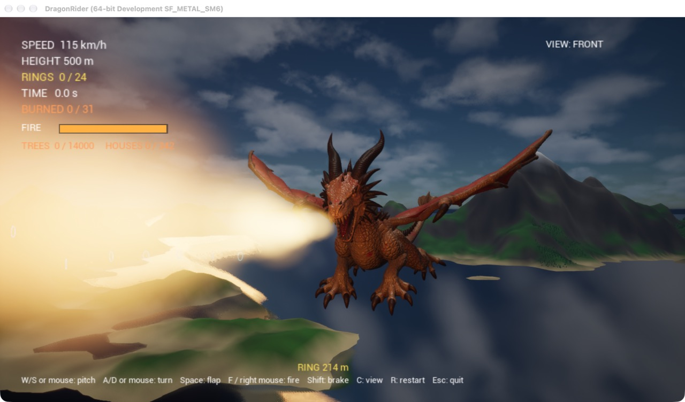
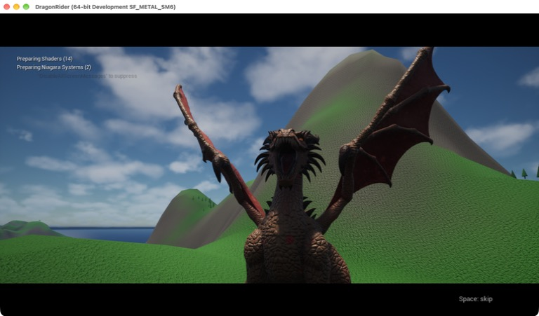
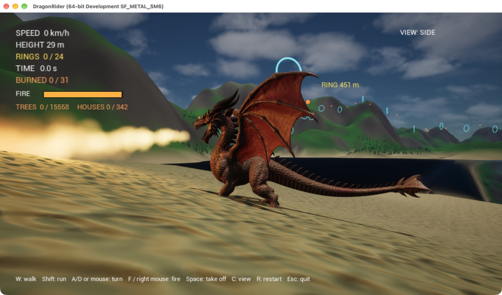

# Dragon Rider（Unreal Engine 5）

騎著龍在群島上空飛行，依序穿過 24 個光環並計時。龍焰可以燒掉漂浮的紅色火燈，也能點燃島上的森林和村莊，火會自己延燒。

整個世界（天空、太陽、雲、海、地形、光環）都由 C++ 在遊戲開始時生成，不需要在編輯器裡做關卡。

## 狀態

已在 Unreal Engine 5.8.4（Mac，Apple M4）編譯並實際執行過。

## 執行

需要 Unreal Engine 5.8、Xcode，以及 Xcode 的 Metal Toolchain（`xcodebuild -downloadComponent MetalToolchain`）。

1. 龍的模型是 Fab 上的免費素材 [Sakura Dragon](https://www.fab.com/listings/4af98b46-6e54-4d22-93dc-0404cc4dc2d2)，授權不允許放進這個 repo。請在 Fab 加入資料庫，再從 Epic Games Launcher 的「Fab Library」按「加入專案」選這個專案，它會出現在 `Content/SakuraDragon/`。沒有它也能玩，龍會是一個圓錐。
2. 對 `DragonRider.uproject` 按兩下開啟編輯器，按 Play。

其餘的貼圖、材質、騎士都已放在 `Content/`。改了 `SourceArt/` 之後，關掉編輯器並執行 `Tools/rebuild_assets.sh` 重建。

龍的顏色在 `DragonPawn` 的 `BodyTint`、`WingTint`、`GlowTint` 調整；設成白色就是素材原本的珍珠白配櫻花粉。

## 操作

| 動作 | 鍵盤滑鼠 | 手把 |
| --- | --- | --- |
| 抬頭 / 低頭 | S / W，或滑鼠上下 | 左搖桿 |
| 轉向 | A / D，或滑鼠左右 | 左搖桿 |
| 拍翅加速 | 空白鍵或滑鼠左鍵 | A |
| 噴火（會耗燃料，放開後回復） | F 或滑鼠右鍵 | RT |
| 減速 | 左 Shift | LT |
| 切換視角（追尾、遠追尾、騎士、正面、側面、俯視） | C | Y |
| 降落（要在島嶼上空、地面不能太陡） | G | X |
| 地面：走路 / 跑步 / 轉向 | W / Shift+W / A、D | 左搖桿 / LT |
| 地面：起飛 | 空白鍵 | A |
| 跳過開場動畫 | 空白鍵或 Enter | A |
| 重新開始 | R | Start |
| 離開遊戲 | Esc | — |

俯衝會加速，爬升會減速，太慢時龍頭會自己往下掉。

每次啟動會先播一段開場：龍站在山腰上咆哮、噴火，然後起飛，接著才交給你操控。降落後龍會站著噴火，可以走到森林或村莊旁邊燒。

## 檔案

- `Source/DragonRider/DragonPawn.*`：飛行、鏡頭、噴火、龍的動畫與配色、騎士
- `Source/DragonRider/DragonAnimInstance.*`：播放飛行動畫，並在噴火時張開下顎
- `Source/DragonRider/DragonProps.*`：森林、村莊，以及點燃、延燒、燒焦
- `Source/DragonRider/DragonWorld.*`：天空、海、地形、光環賽道、火燈
- `Source/DragonRider/DragonHUD.*`：速度、高度、光環數、時間、燃料
- `Tools/build_rider.py`：用 Blender 產生 `SourceArt/rider.fbx`
- `Tools/build_textures.py`：用 Blender 產生 `SourceArt/tex/` 的貼圖
- `Tools/rebuild_assets.sh`、`Tools/setup_assets.py`：匯入騎士與貼圖、建立材質

## 測試用啟動參數

- `-AutoFire`：持續噴火，不耗燃料
- `-View=N`：以第 N 種視角開始（0 到 5）
- `-BurnTest`：開場就點燃起點附近的森林和村莊
- `-LandTest`：一開始就站在最近的平地上
- `-NoIntro`：不播開場動畫
