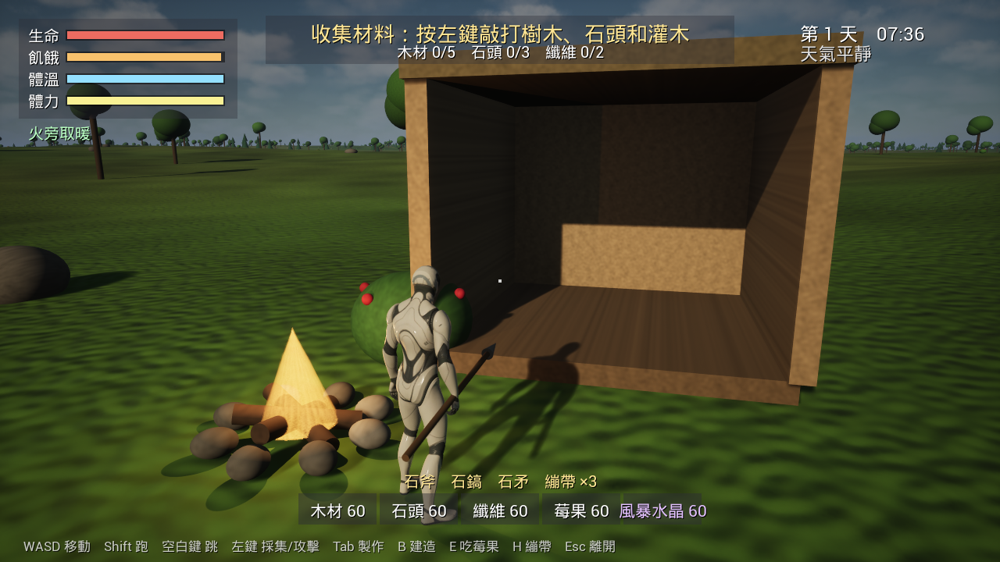
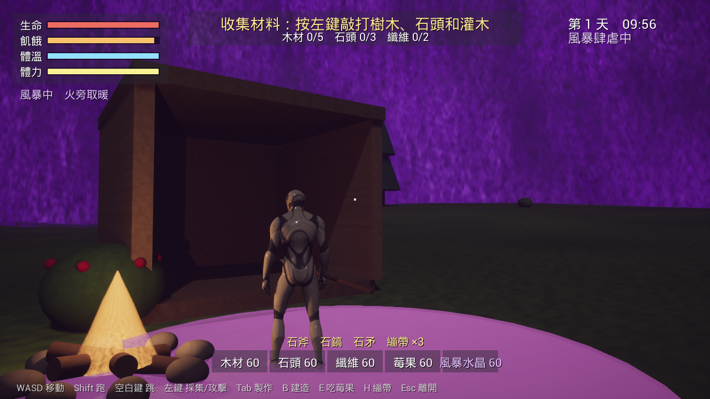

# 風暴之島 (Storm Isle)

A single-player survival and building game in Unreal Engine 5.8. You wake on the beach of an island
that violet storms sweep across. Gather, craft, build a shelter, get through the storms and raise
the beacon that holds them back. The whole interface is in Chinese.

Everything is made in C++ when the game starts: the island, its forests, rocks and bushes, the sky,
and the day and night. No level is built in the editor. The characters are Epic's mannequins.




## Setup

```sh
Tools/get_mannequin.sh      # copies Epic's mannequin pack from the engine (not kept in git)
"/Users/Shared/Epic Games/UE_5.8/Engine/Build/BatchFiles/Mac/Build.sh" StormIsleEditor Mac Development -project="$PWD/StormIsle.uproject"
Tools/rebuild_assets.sh     # builds textures and materials from SourceArt/
```

Run:

```sh
"/Users/Shared/Epic Games/UE_5.8/Engine/Binaries/Mac/UnrealEditor.app/Contents/MacOS/UnrealEditor" "$PWD/StormIsle.uproject" -game -windowed -ResX=1280 -ResY=720
```

Add `-demo` and the game plays through its main moments by itself. It saves a screenshot of each
to `Saved/Demo/` and then quits.

## Playing

| Key | |
|---|---|
| WASD, mouse | move, look |
| Shift / Space | run / jump |
| Left mouse | gather (trees → wood, rocks → stone, bushes → fibre and berries, crystals) and attack |
| Tab, then 1–4 | craft: stone axe, stone pick, stone spear, herbal bandage |
| B, then 1–5 or wheel, left mouse | build: floor, wall, roof, campfire, storm beacon |
| E / H | eat berries / use a bandage |
| Esc | close a menu, or quit |

Gamepads work too.

- **Survival:** health, hunger, warmth and stamina. Night and storms chill you. A campfire warms
  you, and a roof keeps the storm off.
- **Building:** floors and roofs fill 4 m grid cells, and walls stand on the cell edges. The
  preview turns green where a piece fits and red where it does not, with the reason.
- **Storms:** after a calm spell you get a warning and the direction it is coming from. Then a wall
  of cloud rolls across your position. Inside it the world goes dark, marked lightning strikes, and
  storm wraiths come out. It leaves storm crystals behind.
- **Wraiths** hunt you during storms and at night, and burn away in daylight.
- **Goals:** gather → stone axe → campfire → shelter (floor, three walls, roof) → live through a
  storm → five crystals → storm beacon. The beacon's light keeps storms away within 60 m.

## Code

| File | |
|---|---|
| `SIWorld` | island terrain, sea, sky, sun and moon, day/night, storm gloom |
| `SIResources` | trees, pines, rocks, bushes and crystals: instanced meshes, struck, regrown |
| `SIBuilding` | grid placement, preview, campfires, beacon, shelter checks |
| `SICharacter` | the player: input, stats, gathering, crafting, building |
| `SIEnemy` | storm wraiths |
| `SIStorm` | storm cycle, wall, lightning, wraith spawning, crystals |
| `SIQuest` | the run of goals |
| `SIHUD` | everything on screen |
| `SIAnimInstance` | idle/walk/jog/fall blending and one-off actions without an animation blueprint |
| `SIDemo` | the `-demo` run |

The engine appends an AndroidFileServer block with a security token to `Config/DefaultEngine.ini`
when it runs. Remove it before committing.
